# wlperch

✨ **A quick-settings panel, status bar, app launcher, notification center and
lock screen for sway, in one small native Wayland binary.**

wlperch is meant to replace waybar, swaylock, rofi/wofi, dunst/mako and the
usual pile of theme-switch and display-layout scripts with a single coherent,
good-looking, self-contained tool: one look, one config file, one theme switch
for all of it.

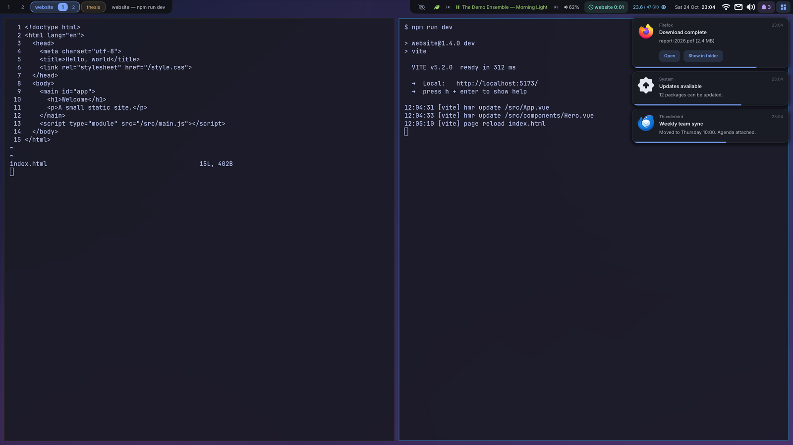

A quick-settings popup for Sway (and other wlroots compositors), written in
[Odin](https://odin-lang.org). It speaks the Wayland protocol directly, using
bindings generated by its own scanner (`tools/wlscan`). It renders with
OpenGL through EGL, using a custom-themed [Dear ImGui](https://github.com/ocornut/imgui).

The popup is a **layer-shell overlay surface**, so it floats above everything and
never enters the tiling tree. It opens on the focused output, anchored to the
top-right corner below your bar by default. Clicking anywhere outside it, or
pressing <kbd>Esc</kbd>, closes it.

## What's in it

| Section | What it shows / does |
|---|---|
| 🕒 **Header** | Big clock and date · tabs for every panel (so the bar needs only one button) · setup and restart buttons. Panels without the big header get the tabs in their title row. |
| 🎛️ **Quick settings** | Toggle tiles: night light (wlsunset), dark mode (see [Dark / light](#dark--light)), do not disturb (wlperch' own while it shows notifications, otherwise dunst's), Bluetooth power, and with projects configured group lock and keep-workspaces · keyboard layout switcher (sway xkb layouts) |
| 🎵 **Media** | The playing track from any MPRIS player (Spotify, browsers, mpv, VLC…): album art (or the app's icon), title, artist, album, a progress bar, and previous / play-pause / next. With several players, a switcher picks one. Hidden while no player runs. `wlperch media play-pause\|next\|previous` from a shell or keybinding. |
| 🔊 **Audio** | Two fix buttons: **refresh** switches the default output's card to another profile and back (cures PipeWire's occasional silent sink) and restores the default output; **restart** restarts PipeWire, WirePlumber and pipewire-pulse (`wlperch audio refresh/restart` from a shell or keybinding). Output and input devices (click to make default) · volume sliders (drag or scroll, up to 150 %) · mute. For HDMI/DP audio on a GPU, every plugged monitor is listed by its **name and sway connector** (`LG ULTRAWIDE · HDMI 2 · DP-3`). Picking one switches the card profile and the default sink. The full profile list is in a dropdown. |
| 🖥️ **Displays** | Your current screen layout, drawn to scale · a dropdown of the display presets from your config, with a mini preview of each layout. Selecting one switches to it, and the active preset is detected and ticked. |
| 🌦️ **Weather** | Today's forecast from open-meteo.com (no API key): current conditions, high/low, rain, wind, humidity, sunrise/sunset, and the next 24 h |
| 🌍 **World clocks** | Any IANA time zones, with UTC offset, difference to local time, and a tomorrow/yesterday badge |
| 🌐 **Network** | Public IP and per-interface addresses. Click any of them to copy it (`wl-copy`). |
| 🎧 **Bluetooth** | Connected and paired devices with battery level (BlueZ `Battery1`, falling back to UPower). Click a device to connect or disconnect it. |
| 🔔 **Notifications** | wlperch is the desktop notification server (see [Notifications](#notifications)): popups in the top-right corner, and this panel keeps the history of the last 7 days, grouped by day, with unread dots, action buttons for notifications the app still listens to, remove / clear all, and do not disturb. |
| 🧮 **Calculator** | Type an expression and the result updates as you type: `sqrt(2) * 0x10`, `floor(7/2)`, `sin(pi/6)`, `5!`, `0xff & ~0b1010`, `2pi`. Shows it as decimal, hex, octal and binary (integers; negatives as 64-bit two's complement) and as IEEE-754: f64 and f32 bit patterns and a C hex float literal (`0x1.8p+1`). Click any of them to copy it. Integers stay exact up to 128 bits. Enter keeps the result as `ans` (an expression starting with an operator continues from it), Up/Down recall the history, RAD/DEG switches the angle unit, and **?** lists the syntax. It has its own popup for a key binding (`wlperch toggle calc`, which takes the keyboard right away), and `wlperch calc <expression>` prints every format in a terminal. |
| 🔒 **Lock screen** | `wlperch lock` replaces swaylock (see [Lock screen](#lock-screen)): a big clock and date, the password field, Caps Lock and keyboard layout, and a status row with the unread notification count (and which apps), what's playing, the battery and connected Bluetooth devices. |
| 🔑 **SSH keys** | Your keys in `~/.ssh` and whether OpenSSH's `ssh-agent` holds them, with the time left (see [SSH keys](#ssh-keys)). **Unlock** asks for the passphrase in wlperch's own popup and adds the key for an hour (`[ssh] lifetime`); **Forget**, **Forget all**, **Lock agent**. Keys are forgotten when the screen locks. A key icon in the bar while any key is unlocked. |
| 💾 **Storage** | Each drive with its mounted volumes: free space and a fill bar (orange from 85 %, red from 95 %). Click a volume to open it in the file manager. External drives (USB / hotplug) also list unmounted volumes with a **Mount** button, and an **eject** button unmounts everything and powers the drive off (udisks, no root needed). Boot, EFI and swap partitions are hidden. While the popup is open, drives you plug in show up within a few seconds. |

| Dark | Light |
|---|---|
| 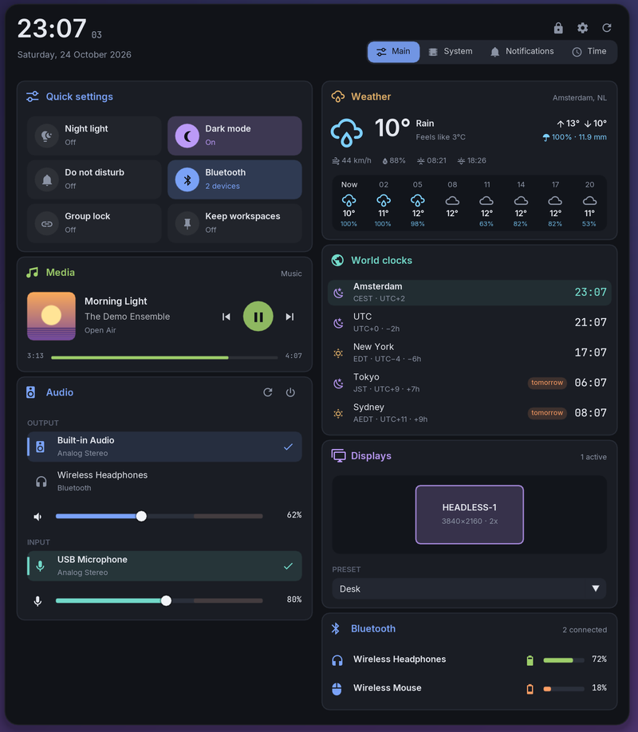 | 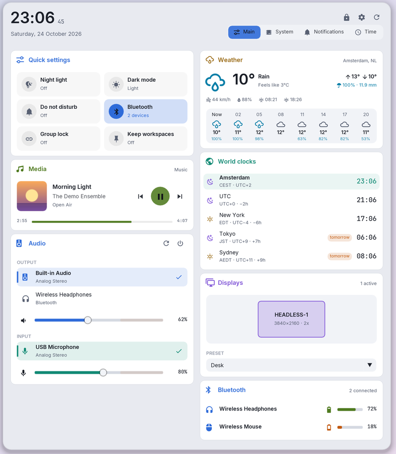 |

### How the HDMI audio → monitor mapping works

PipeWire attaches the monitor name it reads from each HDMI/DP port's ELD
(EDID-like data) to the port as `device.product.name`. Each card profile
(`output:hdmi-stereo-extra1`, …) belongs to exactly one port. That name is then
matched against the `model` that sway reports for its outputs, which gives the
connector (`DP-3`).

### Display presets

Presets live in the config, one `[display.<name>]` section each. Every key is
an output and its value sway's own output settings (a mode, `pos X Y`,
`scale`, `transform`), or `off`:

```ini
[display.desk_and_tv]
name = Desk and TV                         ; optional label
DP-3 = 3440x1440 pos 0 0
DP-1 = 2560x1440 pos 3440 0 transform 90
DP-2 = 1920x1080@60Hz pos 4880 0
HDMI-A-1 = off
workspaces = DP-2: 9 10, DP-3: 1           ; optional: where these workspaces live
run = pactl set-card-profile …             ; optional: run after switching
```

A config written from scratch starts with the layout found on the first run
(`[display.default]`), and with several monitors also `all` plus an
`only-<output>` preset for each monitor on its own.

```
wlperch display                  # list ("*" = the current layout)
wlperch display desk_and_tv      # switch (section name, label or number)
wlperch display next             # cycle (prev too): handy on a key binding
wlperch display save couch "Couch"   # add the current layout as a preset
```

Switching talks to sway directly (enabling the new outputs before turning
others off) and writes the layout to `~/.config/sway/config.d/wlperch-displays.conf`,
so sway starts with it next time. Presets are re-read every time the popup
opens; no restart needed.

## Panels

The popup is made of **panels**, each built from modules laid out in columns.
`wlperch toggle <panel>` opens one. If another panel is already open, it
switches in place. The first panel in the config is the default.

| Panel (built-in) | Modules |
|---|---|
| `main` | header · quick · media · audio · calculator \| weather · clocks · displays · bluetooth |
| `system` | cpu · memory · storage \| gpu · thermals · network \| processes |
| `sensors` | sensors (only when sensors are configured) |
| `notifications` | notifications |
| `time` | time |
| `calc` | calculator (no tab: `tab = false`; open it with a key binding) |
| `launch`, `run` | launcher (no tab; added even when your config defines its own panels) |
| `github` | github \| github-repo · github-inbox (only when `[github] enabled = true`) |
| `ssh` | ssh (no tab; the quick settings tile and the bar's key icon open it; added even when your config defines its own panels) |

Modules: `quick audio network weather clocks displays bluetooth storage cpu gpu memory processes thermals sensors time notifications media calculator launcher ssh github github-repo github-inbox`.

The system panel's graphs keep the last hour. Scroll over any of them to zoom
(they zoom together); zooming out from the live view stays live. Dragging or
zooming into the past freezes the view until you double-click it or reopen the
popup.

- **cpu, memory, gpu:** large history graphs. CPU adds load average, per-core
  bars and uptime. Memory shows used/cache/free and swap, and turns red past
  `[memory] critical_percent`. GPU adds VRAM.
- **thermals:** CPU and GPU temperature history, power history (GPU through
  NVML, against its power limit; CPU package through the RAPL energy counter),
  every useful hwmon temperature (motherboard inputs that are unconnected or
  duplicated are filtered out), and the fans.

  **CPU power** needs read access to `/sys/class/powercap/intel-rapl:0/energy_uj`.
  It's root-only by default (a side-channel mitigation). To allow it, add a udev
  rule:
  ```
  # /etc/udev/rules.d/90-rapl.rules
  SUBSYSTEM=="powercap", ACTION=="add", RUN+="/bin/chmod 0444 /sys%p/energy_uj"
  ```
  Then run `sudo udevadm trigger --action=add --subsystem-match=powercap` or reboot.
- **processes:** top 8 by CPU (% of one core, like `top`) and by resident
  memory. Processes are grouped by executable, e.g. `firefox ×38`. This is
  sampled every 2 s, and only while the module is on screen.
- **sensors:** Tuya WiFi devices, read directly over the LAN
  ([setup](#sensors)). Rooms show temperature, humidity and battery;
  air-quality monitors show CO₂ (with a verdict), PM1/2.5/10 and HCHO; heaters
  show on/off and current/target temperature. Readings older than 3 h are dimmed.

- **time:** time tracking by workspace (see below).
- **github, github-repo, github-inbox:** GitHub through the `gh` command line
  tool, read-only (log in once with `gh auth login`). `github` is what
  `gh status` reports, as a status board: counters for review requests, your
  open pull requests (and how many have failing checks), assigned issues and
  unread notifications, then the review requests, your pull requests with their
  checks and review state, and your assigned issues. `github-inbox` lists unread
  notifications, the ones addressed to you (mentions, review requests,
  your threads) first. `github-repo` follows `[github] repo`: its default
  branch's checks, open pull requests and issues, latest release and the last
  workflow runs. Everything opens in the browser. Refreshes every
  `refresh_minutes` (5), and when the panel opens on stale data.

Define your own panels with `[panel.NAME]` sections (see Configuration).

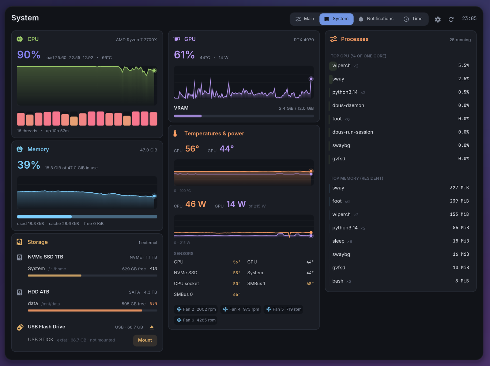

### Time tracking

Each `[project.NAME]` gets its own workspace on every monitor, named after the
project and numbered left to right (`ACME 1`, `ACME 2`). Starting a project from
the Time panel, or with `wlperch track <project>`:
- creates those workspaces;
- pins each one to its output;
- shows them all, keeping focus on the monitor you were using.

Doing it again simply recreates them after sway has removed them as empty.

Project workspaces have names rather than numbers, so sway's `$mod+N`
bindings can't reach them. The sway file binds the "current project" commands
instead. Without a name, they target the project you're in, or else the one you
used last: `$mod+p` runs `track go` and `$mod+Shift+p` runs `track move`.

`track move` puts the window on the project's workspace for the monitor you're
on, creating it if needed, and leaves your view alone (like `$mod+Shift+N`).

**Gathering misplaced windows:** `track pin` (`$mod+Ctrl+p`, or right-click a
project in the Time panel) locks the current project as the target for a minute.
Every move extends it. While pinned, you can visit any workspaces, including
another project's, and `$mod+Shift+p` sends windows to the pinned project. A
notification marks the start and end, and the Time panel shows a countdown.
`track pin off` ends it early.

**Group lock** (a toggle in the Time panel, or `wlperch track lock [on|off]`)
keeps the monitors together. Switching one monitor to a project workspace
brings the others to that project's workspaces too. Leaving it sends the others
back to what they showed before. Focus stays on the monitor you used. The
setting is remembered. Right-click a workspace in the bar to switch only that
monitor.

**Keep empty workspaces** (a toggle in the Time panel, or `wlperch track keep
[on|off]`) stops sway from removing a project workspace once it's empty and you
look away. Every empty project workspace gets a placeholder window (app_id
`wlperch-placeholder`, titled "ACME 2 · placeholder"). It's a translucent tile
with no border, and a centered card shows the project name in its color, the
workspace number and a hint. The label is software-rendered (stb_truetype into
shared memory) on a subsurface, so placeholders never need the GPU. It goes there
through a sway `for_window` rule, so it never flashes elsewhere or takes focus,
and it closes as soon as a real window arrives. If you close a placeholder
yourself, that workspace is left alone until it disappears.

Time counts while one of a project's workspaces is focused. Numbered
workspaces are not counted. Counting pauses after `[timetracker] idle_seconds`
without input (default 300; the older `idle_minutes` is still read), and the
idle time itself is not counted. wlperch asks the compositor for its own
`ext-idle-notify-v1` notification with that timeout, so it is independent of
the screen lock: e.g. `idle_seconds = 60` for breaks while swayidle still locks
after 300 s. Idle inhibitors (a fullscreen video with sway's `inhibit_idle`, an
app holding an inhibitor, the bar's idle button) count as presence, as they do
for swayidle: watching a talk or sitting in a call is not a break.

Finished segments are appended to `~/.local/share/wlperch/timelog.tsv`, one
per line: start and end (UTC, ISO 8601), project, client.

**Breaks are tracked too.** Every walk-away (no input for `idle_seconds`) is
logged as its own line with a fifth column `idle`. It runs from the moment
input stopped to your return, and is attributed to the project whose workspace
was focused when you left (or `(no project)`). The panel's "Away from keyboard"
section shows, per project, the breaks today and this week, the total time away,
and how long you work on average before walking away ("every 42m"). The open segment is
written to `timetracker.current` every 30 s, so a crash loses at most that.
Segments shorter than 5 s are dropped.

**Short breaks can count as work** ("bridging"), for projects where you often
wait a bit before going on (a build, a test run, a colleague). Set
`bridge_breaks = <minutes>` (0–120, 0 = off) in a `[project.KEY]` section, or
`[timetracker] bridge_breaks` for every project without its own (Settings →
Time tracking). Quicker: the pencil at the end of the project's row in the Time
panel offers Off / 2 / 5 / 10 / 15 / 30 min, and the row then says
"breaks < 10 min count". A break shorter than that, between two stretches of
work on the *same* project, counts as work for it. A break between two
projects, one with no work on the project after it (the end of the day), or a
longer one stays a break; breaks back to back (a restart, a single key press in
between) count as one. The log is left as recorded: bridging is applied when
the time is counted (panel totals, timeline, 7-day chart, export, bar), so a new
value applies to past days too, and setting it back undoes it. The timeline
hatches bridged gaps in the project's colour, and "Away from keyboard" lists
them as "N short, counted as work" instead of as breaks.

**Paying jobs and rates.** `paying = true` in a `[project.KEY]` section (or the
"Paying job" switch under the project's pencil in the Time panel) marks a paid
job: a cash icon on its row and in the bar's timer. Give it `rate = 85` (the
same editor has the field; `[timetracker] currency`, default `€`, is the unit)
and the panel shows today's amount next to its time, the export preview adds
the total for the range, and the CSV fills in `rate` and `amount` for its work
rows.

**Claude's background work.** While Claude Code works in a terminal, it spins
the terminal's title: `◐ task`, `◑ task`, alternating about once a second
while focused and frozen on one of them while not (`✳ task` when it's done).
wlperch watches sway's window titles, so it knows when Claude is working on
one of a project's workspaces, whether or not that workspace is focused or
you're at the keyboard. Each such stretch is logged with a fifth column
`claude`, from when the spinner appears until it's gone (`✳`, another title,
or the window closed). A spinner only counts while a `claude` process still
runs in that terminal, so one left behind by a Claude that died doesn't. With `claude_counts = true` (or
"Count Claude's background work" under the pencil) those minutes count as work
for the project. Where you were working on it yourself, or a bridged break
already counts, it counts once; two Claude terminals on one project count
once too. Like bridging this is applied when counting, so switching it on
counts past days, and off leaves the log alone. The Time panel says what Claude
is working on right now ("counts"), its rows show a sparkle icon (bright while
it works), and the bar shows the project with class `claude` when nothing of
yours is counting. Today's timeline has one lane per project, because Claude
can be working on one while you work on another; Claude's counted time is a
lighter fill with a solid top edge.

While you're away from such a project, the timer can't know yet whether you'll
be back in time, so it doesn't count: the panel shows the project dimmed with
"waiting…" and how long you have left, and the bar's pill turns dim (class
`waiting`). Back on the project within the window and the gap is added at once
(the panel's counter then runs from before the break); once the window has
passed, it is an ordinary break.

**Renaming a project.** The pencil at the end of a project row in the Time
panel, or `wlperch track rename [--dry-run] [--merge] [--workspaces] OLD NEW`.
The name new time is logged under comes from config.ini (`name =` of the
`[project.*]` section), and the workspaces `OLD 1`, `OLD 2` are what count as
the project. A rename changes the log lines and the config section (colour and
client kept) and, if you choose, the sway workspaces. Leave them alone and they
stop counting until you reopen the project under its new name, so the panel
renames them by default and the CLI does when given `--workspaces`. Names match
exactly (`wl` never touches `wlwidgets`; case counts). Both files are backed up
first as `*.before-rename-<time>` (copy them back and `wlperch restart` to undo).
Renaming onto an existing project merges the two. The CLI needs `--merge` for
that and the panel asks twice. Where the two overlap in time, the overlap counts
once. `--dry-run` shows what would change.

**Exporting hours** (e.g. for a monthly invoice). The Export section at the
bottom of the Time panel: pick a project (or all), This month / Last month /
Custom (both days included) / All time, and the rows. "Export CSV" saves to
your Documents folder (`XDG_DOCUMENTS_DIR`) as
`wlperch-hours-<project|all>-<range>.csv`. From a terminal:

```sh
wlperch track export --month last --project wlperch --by day -o hours.csv
wlperch track export --from 2026-10-01 --to 2026-10-15 --by project
```

| `--by` | Columns (one row per …) |
|---|---|
| `entries` (default) | `date,start,end,minutes,hours,project,client,type,rate,amount`: each tracked stretch |
| `day` | `date,project,client,minutes,hours,type,rate,amount`: each day and project |
| `project` | `project,client,minutes,hours,days,type,rate,amount`: each project in the range |

Times are local, entries are cut at the range's ends and at midnight (so each
row is one day), `hours` has two decimals computed from the seconds (sum those,
not the rounded `minutes`), and `client` comes from the log line. Breaks are
left out unless you ask for them (`--breaks`, or "Include breaks"; `type` is
then `work` or `break`). Bridged breaks are worked hours, so they are in the
`work` rows; with `--breaks`, entry rows mark them `bridged` instead (still
worked hours: work + bridged = the hours the panel shows). Claude's counted
background work is in the `work` rows of `day` and `project`; entry rows mark it
`claude`. `rate` and `amount` (hours × rate, two decimals) are filled in for the
work rows of paying projects with a rate, and empty otherwise. The segment that
is counting right now, and what Claude is doing now, are included.

The Export section also has a "Count breaks shorter than" slider (0–120 min, with
− / + for single minutes). It starts at the configured value. Moving it changes
only this export, and the line under it previews the effect for the chosen
project and range, e.g. `15:35 h → 18:48 h (+3:13 h from 38 bridged gaps)`.
"Save N min for <project>" writes it as the project's `bridge_breaks`, and
"↺ as configured" goes back. From a terminal, `--bridge MINUTES` does the same
for every project (0 = no bridging), and stderr shows the same with/without line:

```sh
wlperch track export --month last --project wlperch --bridge 10 -o hours.csv
# 1 rows, 10:08 h worked (10.14 h) -> hours.csv
# bridging (--bridge 10): 7:56 h → 10:08 h (+2:12 h from 25 bridged gaps)
```

The panel shows:
- the running timer;
- the projects as quick-switch rows with today's totals;
- a bar of today's time against an 8 h day;
- a 24 h timeline of today. Scroll over it to zoom (down to 15 minutes, around
  the pointer), drag to pan, double-click to see the whole day again.
- a 7-day stacked chart (hover a day for its breakdown).

`wlperch status timer` feeds a waybar pill (`⏱ ACME 1:23`, class `running`;
`waiting` while a bridgeable break may still count).

### Sensors

Tuya WiFi thermo-hygrometers, air-quality monitors and heaters are read
directly over the LAN, without the cloud and without tinytuya: wlperch speaks
the local protocol itself (3.3, 3.4 and 3.5; only status queries, it never
sends commands). Sensors are off until you define devices. Each device needs
its id and **local key**, which only the Tuya cloud knows. Fetch them once,
e.g. with [tinytuya](https://github.com/jasonacox/tinytuya)'s wizard
(`python -m tinytuya wizard`), which writes a `devices.json`.

There are two ways to define devices, and they can be mixed:

- `[sensors] dir`: a directory with a tinytuya `devices.json`. Names, local
  keys and data point mappings (codes, units, scales) are taken from it.
- `[sensor.<name>]` sections in the config:

  ```ini
  [sensor.kitchen]
  id = bf0123456789abcdefghij
  key = 0123456789abcdef        ; local key: chmod 600 the config
  kind = room                   ; room | air | heater (built-in data point layout)
  # name = Kitchen              ; default: the section name
  # ip = 192.168.1.20           ; default: learned from the broadcasts
  # version = 3.4               ; idem
  # dp1 = va_temperature 1 ℃    ; data points: code, decimals, unit (replace the built-in layout)
  ```

  A section with the id of a `devices.json` entry overrides its fields
  (e.g. `name`).

The built-in layouts are the usual Tuya thermo-hygrometer
(1 temperature ÷10, 2 humidity, 4 battery), the common MT15/MT29-style
air monitor (CO₂, PM1/2.5/10, HCHO, …) and a basic heater (switch, target and
current temperature, mode). Data points without a mapping show up as `dpN`.

Battery sensors sleep with WiFi off and only wake for a few seconds, on a
timer or when a value changes. The daemon listens for the devices'
discovery broadcasts on UDP 6666/6667/7000, sends the discovery probe every
6 s (3.5 devices only announce themselves when asked), and queries a device
over TCP 6668 the moment it announces itself (at most every 30 s). Devices
with both `ip` and `version` configured are also asked every 5 minutes. The
last value of every data point is kept in `~/.local/share/wlperch/sensors-state.json`
(the `state.json` format of tuya-sensors; on the first run it is seeded from
`<dir>/state.json`), which `wlperch status sensors` reads too.

Two commands help with the setup (both read-only):

```
wlperch sensors scan [seconds]   # devices announcing themselves: id, address, protocol version
wlperch sensors read <name|id>   # query one configured device once, print its data points
```

`[sensors] watch` (the tuya-sensors watcher that older versions ran) is
ignored now. Some old 3.3 firmware ("device22") only answers status queries
sent as a control command; wlperch doesn't send those, so such devices are not
supported.

Readings are kept in `~/.local/share/wlperch/sensors.bin`, a small binary file
holding only the last 7 days (older samples are dropped as they age out), so
history survives restarts without growing. An older `sensors.tsv` is imported
once and removed. Hover a room, the air monitor or the heater to see 24-hour
graphs of each value.

### Notifications

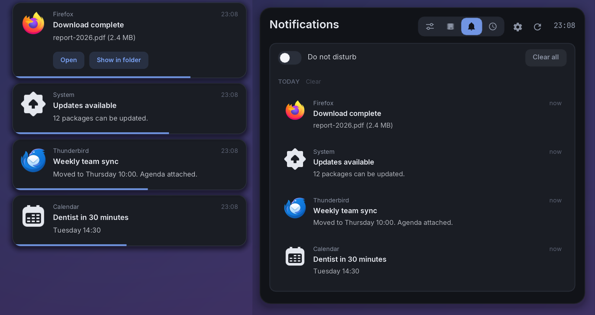

Popups don't time out while you're away: after `[notifications]
hold_when_idle` seconds without input (default 5) they stay on screen, and
once you're back each gets its full time again. Idle inhibitors (a playing
video) count as activity, so they time out normally while you watch.

wlperch serves `org.freedesktop.Notifications`, so apps' notifications
(`notify-send`, browsers, chat apps…) show as its own popups instead of
dunst's or mako's. Only one program can hold that name. wlperch queues for
it and takes over as soon as the other daemon stops. **Setup → Notifications →
Take over** masks the other daemon's systemd unit (`dunst.service`), so D-Bus
can't start it again, and stops it. **Hand back** unmasks it, sets
`[notifications] enabled = false` and restarts wlperch, so the other daemon
gets the name again.

Popups stack in the top-right corner, newest on top, at most four at a time.
- **Click:** runs the notification's default action, or focuses the app's window.
- **Action buttons:** invoke that action.
- **× or right click:** dismisses it; **middle click** dismisses all.
- **Hover:** pauses the timeout.

Timeouts are 5 s for low urgency and 8 s for normal; critical notifications stay
until dismissed, and an app may set its own timeout.

Notifications from the same app in a row, with nothing from another app in
between, are shown together:
- **The same text again** (“Claude is ready” for the 40th time) is one entry
  with a counter (×40), in the popup and in the panel.
- **Different messages** (a chat): one popup, the newest, says how many are
  new (“Signal · 5 new”). In the panel they're one group under the app's icon,
  the newest three shown and the rest behind “N more from Signal”. Each
  message keeps its own actions and remove button. When the picture changes
  (someone else in the chat says something), theirs shows small on the
  group's thread.

A notification that times out stays in the Notifications panel, unread. Opening
the panel marks everything read. Volume and brightness indicators (a replace tag
plus a value, like `notify-send -h int:value:65 -h string:x-canonical-private-synchronous:volume`)
replace each other in place, show a progress bar and stay out of the history.

**Do not disturb** holds popups (critical ones and volume/brightness indicators
still show); everything waits in the panel. Toggle it from the panel, the Quick
settings tile, `wlperch notify dnd`, or right click on the bar bell.

**Fullscreen games** keep popups off their monitor (`[notifications]
fullscreen`, default `games`). Popups that would land there (on the focused
monitor) show on another monitor instead, or, when every monitor is covered,
wait with their timers paused and appear once the game leaves fullscreen
(the newest four; the rest wait in the panel, unread). Critical notifications
and volume/brightness indicators still get a 10 s glimpse over the game when
there's no other monitor, then wait too. The low-memory card follows the same
rule (its history entry is written right away), and the idle-lock countdown
skips a covered monitor. A small gamepad next to the bar bell, and a line in
the Notifications panel, tell you popups are being kept off a monitor.

- **What counts as a game:** a fullscreen window (sway's `fullscreen_mode`,
  per monitor's visible workspace, or global fullscreen over all of them) whose
  X11 class is `steam_app_*`, `gamescope` or ends in `.exe`, or whose process
  or one of its first parents is a wine / wine-preloader / wineserver /
  gamescope process, a `*.exe` (wine names its processes after the program),
  Proton or Steam's `reaper SteamLaunch`, or carries `SteamAppId`,
  `SteamGameId`, `STEAM_COMPAT_APP_ID` or `LUTRIS_GAME_UUID` in its
  environment. `/proc` is read once per new fullscreen window.
- **`all`:** any fullscreen window (video players and browsers too).
- **`off`:** popups show over fullscreen windows, as before.

- **Rendering:** popups are drawn in software into shared memory, so a
  notification never wakes the GPU.
- **Icons:** come from the app's image data, an image file (PNG/JPEG, or SVG
  through librsvg when installed) or your icon theme.
- **History file:** `~/.local/share/wlperch/notifications.bin`, binary, last
  7 days, at most 300 entries, icons stored once.

### Low-memory warning

When available memory (`MemAvailable`, so page cache that can be dropped
counts as free) falls below `[memory] warn_free_percent` of RAM (15 % by
default), a red card drops down at the top centre of the screen:

- **What it shows:** available / total memory and the biggest memory users
  by resident memory, grouped by executable like the processes module
  (`firefox ×40`). It updates every second while it's up.
- **SIGTERM / SIGKILL:** one of each per row. On a `×N` row they signal every
  process of that group. SIGKILL asks first: the button turns red, *Really
  kill?*, and a second click within 4 s sends it.
- **Never offered:** PID 1, sway, Xwayland, your systemd user manager and
  wlperch itself (shown greyed out as *protected* when they rank). Other
  users' processes are left out.
- **When it goes:** × closes it for this episode; it also goes by itself once
  memory recovers. It comes back only after available memory has climbed 5 %
  above the threshold and fallen below it again, so it doesn't flap.
- **Always shown:** also under do not disturb, with no timeout. Each episode
  is logged once in the notification history.
- **No GPU needed:** drawn in software into shared memory like the
  notification popups, by the daemon (which samples memory anyway).

**The bar** starts drawing attention sooner: its memory module turns orange
and slowly pulses (a ~2 s breath, at most 8 redraws a second, and only while
orange) from `bar_warn_percent` memory use (75 %), and turns solid red at
`critical_percent` (90 %).

**Trying it out** without running out of memory: start the daemon and the
bar with `WLPERCH_TEST_MEM_AVAILABLE=<file>`, and write the available
percentage to pretend into that file (`echo 8 > file`). It's re-read every
sample. This is a test hook: without the variable, `/proc/meminfo` is used.

### Lock screen

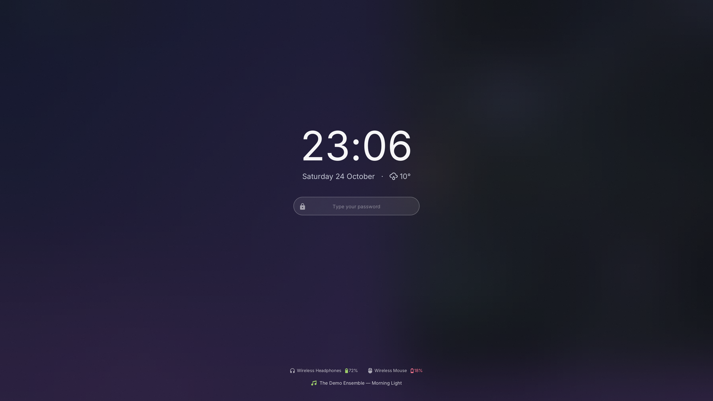

`wlperch lock` locks the session with the `ext-session-lock-v1` protocol
(sway 1.8+), like swaylock. `wlperch lock -f` returns once the screen is
locked, which is what swayidle's `before-sleep` needs.
`wlperch lock --screen-off` also powers the monitors off once locked; the
first key press or mouse movement turns them back on (the monitor button
next to the lock button in the main panel does this).

- **Focused monitor:** shows the clock and date (with the weather), the
  password field, Caps Lock and the keyboard layout, and a status row along
  the bottom:
  - the unread notification count and which apps sent them, never their text;
  - what's playing (any MPRIS player);
  - the battery;
  - above it, the connected Bluetooth devices with their battery when known
    (red at 20 % or less); hidden when none are connected or Bluetooth is
    off. While the screen is locked the daemon re-reads BlueZ at most every
    30 s.
- **Other monitors:** the same password field and status rows
  (`all_monitors = true`, the default); typing goes to all of them at once.
  With `all_monitors = false` they show only the clock.
- **Password:** checked with PAM, in a separate thread so the clock keeps
  running. The PAM service is `swaylock` when `/etc/pam.d/swaylock` exists,
  else `login`; set `[lock] pam_service` to change it. After three wrong
  passwords, each further one makes you wait longer, up to 30 s.
- **Keys:** Enter submits, Escape or Ctrl+U clears, Backspace deletes.
- **Background:** a colour, or a picture from `[lock] image`, which can be
  blurred and darkened (see [Configuration](#configuration)).
  `[lock] background_mode = blur` instead shows the screen as it was when
  it locked, as frosted glass, at `screenshot_blur` strength (0–100). It's
  off by default, and **Setup → Lock screen** can switch it on with a
  strength slider.
  - **Privacy:** even strength 0 blurs by a 20 px radius, so no text stays
    readable. The copy stays in memory and is never written to disk.
  - **Capture:** uses ext-image-copy-capture, or wlr-screencopy if the
    compositor lacks it. When the mode is off, neither protocol is touched.
  - **Fallback:** if the capture fails or takes over 300 ms, the lock goes
    ahead with the plain colour.
  - **Growing blur (opt-in):** with `blur_animate_ms` (up to 3000) the blur
    starts at `blur_animate_from` percent of its strength (default 10;
    0 = sharp) and grows to the full strength, easing out. Until it has
    grown, what was on screen can be partly readable, so it's off by
    default. `wlperch lock -f` (swayidle's timeout, before-sleep) never
    animates: a machine never wakes up to a readable screen. Typing works
    during the animation. Each frame blurs the previous one a little more
    (on a reduced copy, about 5 ms per 3440x1440 output) at up to 60 fps;
    the last frame is exactly the static picture, and then the lock goes
    back to drawing only when something changes.
- **Rendering:** in software, like the notification popups.

It runs as its own process, never inside the daemon, and appears as
`wlperch-lock` in `ps` and `pgrep`. The data comes from the daemon when it
runs (the notification count and weather) and is read directly otherwise
(media, battery).

Only a correct password unlocks. If the locker crashes or is killed, the
session stays locked: sway shows a red screen. Then switch to a text console
(Ctrl+Alt+F2), log in and run
`WAYLAND_DISPLAY=wayland-1 SWAYSOCK=$(ls /run/user/$UID/sway-ipc.*) wlperch lock`.
That new locker takes over the lock, and its password unlocks the session.
Unlike swaylock, there is no "unlock on SIGUSR1", so `loginctl unlock-session`
doesn't unlock it.

**Countdown before the idle lock.** `[lock] countdown_seconds` (15 by
default, 0 = off) seconds before the screen locks for inactivity, every
monitor dims from its edges inwards and a card in the middle counts down in
a draining ring. Move the mouse or press a key and it disappears; that
input goes to your app as usual, because the overlay never takes the
keyboard or the pointer.
- **Timing:** swayidle still does the locking, and nothing in its config
  changes. The daemon reads the lock timeout from this session's running
  swayidle (`timeout 300 'wlperch lock -f'` shows the countdown from 285 s)
  and gets told by the compositor when you've been idle that long. Both
  count from the same last input and both wait while an idle inhibitor is
  active (a playing video), so the countdown reaches 0 as the screen locks.
  If the daemon isn't running, the screen still locks, without the
  countdown. **Setup → Lock screen** shows what it found.
- **Without an idle lock in swayidle** (only `before-sleep`, say), set
  `[lock] idle_lock_seconds` to make wlperch lock by itself after that many
  idle seconds, with the countdown before it. This needs the daemon
  running. If swayidle would lock earlier, its lock still wins.
- **Not shown** while the screen is locked, and a lock that comes another
  way (the lock key, `before-sleep`) ends it. `wlperch countdown-preview
  [seconds]` shows it without locking.

**Setup → Lock screen → Use wlperch lock** switches an existing swaylock
setup over:
- **What changes:** every `swaylock` command in your sway config,
  `config.d/*`, `~/.config/sway/*.sh` scripts and `~/.config/swayidle/config`
  becomes `wlperch lock`, keeping `-f`. A `pgrep swaylock` becomes
  `pgrep wlperch-lock`. swaylock's own options, such as `-i image`, are
  dropped.
- **Backups:** each file is copied to `~/.local/share/wlperch/lock-backup/`
  first. Symlinked dotfiles are edited through the link.
- **Without swaylock:** if nothing uses swaylock yet, setup adds
  `config.d/wlperch-lock.conf` instead, with swayidle and `$mod+Alt+l`.
- **Applying it:** setup reloads sway and restarts this session's swayidle.
- **Switch back:** restores the copies.

To wire it up by hand, see the commented lines in
[`contrib/sway/wlperch.conf`](contrib/sway/wlperch.conf).

### Launcher

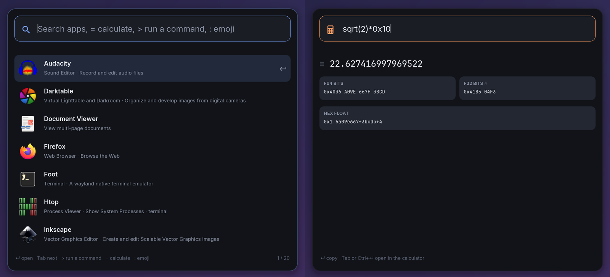

`wlperch toggle launch --center` is an app launcher in place of rofi, wofi or
fuzzel; `wlperch toggle run --center` runs commands, like their run mode, and
`wlperch toggle emoji --center` is an emoji picker.

- **Apps:** the desktop entries in `~/.local/share/applications` and the
  `applications` folder of every `$XDG_DATA_DIRS` entry (Flatpak's too), with
  their theme icons. Hidden entries and entries for other desktops
  (`OnlyShowIn`/`NotShowIn`, `TryExec`) are left out, and names follow your
  locale.
- **Matching:** every typed word has to match the name, the program, the
  generic name, the keywords, the description or the categories. A match at
  the start of the name or of a word counts most; scattered letters count
  too (`ff` finds Firefox). Desktop actions, such as "Firefox: New Private
  Window", show up while searching.
- **Ranking:** apps you start often and recently come first, also in the list
  you see before typing. The counts are in `~/.local/share/wlperch/launcher.tsv`.
- **Calculator:** a sum (`sqrt(2)*0x10`, `floor(7/2)+1`, `=pi/4`) shows its
  result as the first row, with hex, binary, f64 bits and hex float chips
  (click one to copy it). Enter copies the result; Tab or Ctrl+Enter opens it
  in the calculator panel. A lone number such as `0xff` shows its conversions
  after any app that matches.
- **Panels:** wlperch's panels are in the list too (type `sys` for System).
- **Commands:** start with `>` (the run panel starts with it). The programs on
  your `$PATH` are listed; Enter runs the selected one with what you typed
  after it, or the typed line through `sh`; Shift+Enter runs it in a terminal;
  Tab completes the program name. With nothing matching an app search, Enter
  runs the text as a command.
- **Emoji:** start with `:` (`:thumbs`), or open the emoji panel. Words
  match the emoji's name and keywords (`:party`, `:heart red`); add `dark`,
  `light`, `medium`… for skin tones. Enter types the emoji into the window
  you were in (with `wtype`; without it, Enter copies), Shift+Enter or Ctrl+C
  copies it. Emoji you use come first. A plain search also lists up to three
  emoji whose name starts with a typed word, after the apps. The table
  (Unicode 15.1 names and groups, emojilib keywords) is built into wlperch;
  `tools/emojigen` regenerates it, see `assets/emoji/LICENSE.txt`. Pictures
  come from your colour emoji font (Noto Color Emoji) through Pango.
- **Keys:** Up/Down (or Ctrl+N/P, Ctrl+J/K), Page Up/Down, Enter, Escape.
- **Terminal:** apps with `Terminal=true` and Shift+Enter use `[launcher]
  terminal`, else `$TERMINAL`, sway's `$term`, or the first of foot, kitty,
  alacritty, wezterm, ghostty, gnome-terminal, konsole and xterm installed.
- **Starting:** apps run detached from wlperch, in their `Path` folder.

**Setup → Launcher → Use wlperch's launcher** switches your existing launcher
keys over:
- **What changes:** in your sway config and `config.d/*`, launcher commands
  become wlperch's: `rofi -show drun|combi`, `wofi --show drun`, `fuzzel`,
  `tofi-drun` and `j4-dmenu-desktop` open `launch`; `rofi -show run`,
  `wofi --show run`, `tofi-run`, `bemenu-run`, `dmenu_run` and `wmenu-run`
  open `run`; `rofi -show calc` opens the calculator; emoji pickers
  (`rofi -show emoji`, `wofi-emoji`, `rofimoji`, `bemoji`) open `emoji`. So
  `set $menu wofi --show drun` becomes `set $menu wlperch toggle launch --center`.
- **What stays:** dmenu-style uses (`cliphist list | wofi --dmenu`), window
  switchers (`rofi -show window`) and comments.
- **Backups:** each file is copied to `~/.local/share/wlperch/launcher-backup/`
  first. Symlinked dotfiles are edited through the link.
- **Without a launcher:** setup adds `config.d/wlperch-launcher.conf` with
  `$mod+d`, `$mod+Shift+d` and `$mod+period` (emoji).
- **Applying it:** setup reloads sway. **Try it** opens the launcher;
  **Switch back** restores the copies.

### Dark / light

`wlperch theme dark|light|toggle|status`, or the **Dark mode** tile in Quick
settings, switches wlperch and the rest of the desktop. Without the daemon
running, the CLI switches the desktop itself and prints what it changed.

- **wlperch:** the panels, notification popups, setup window, launcher and
  bar (with its tooltips and tray menus) switch at once, also when only the
  CLI ran: the bar watches the saved mode. In light mode the accent colours
  are darker so coloured text stays readable on white. The lock screen follows the mode it is started in (a light
  background from `[lock] background_light`, unless a picture is set).
- **GTK, libadwaita and portal apps:** the gsettings `color-scheme`
  (`prefer-dark` / `prefer-light`), which Firefox, Chromium, Electron and
  libadwaita apps follow through the settings portal. With `gtk_theme =
  auto` (the default) the GTK theme switches between Adwaita and
  Adwaita-dark while one of those is in use. An existing
  `gtk-3.0`/`gtk-4.0` `settings.ini` gets `gtk-application-prefer-dark-theme`
  (and `gtk-theme-name`, when it sets one).
- **Symlink twins:** each path in `[theme] links` that is a symlink to a file
  with "dark" or "light" in its name is pointed at its twin, when that exists.
  The default covers `~/.config/waybar/colors.css` and
  `~/.config/wofi/colors.css`, and waybar reloads (SIGUSR2, only the waybars of
  this session) when one of its files changed.
- **sway's window decorations:** with `sway_colors = auto` (the default, per
  mode) the titlebars and borders (`client.focused`, `focused_inactive`,
  `focused_tab_title`, `unfocused`, `urgent`, `placeholder`, `background`)
  are set over sway IPC in wlperch's palette: dark is the familiar
  `#232836` / `#1a1d24` / `#111318` set, light has white-grey titles with
  dark text and a blue tint on the focused one, like the light bar. A
  `swaymsg reload` resets them to your sway config's colours; the daemon sees
  sway's reload event and applies the mode's colours again (also when it
  starts, once a mode was saved). Change one class with
  `sway_client_<class> = border background text [indicator child_border]`
  (e.g. `sway_client_urgent = #d6264f #d6264f #ffffff`), or set
  `sway_colors = off` to leave sway's colours alone.
- **Per mode** (`[theme.dark]`, `[theme.light]`; empty = leave alone):
  `wallpaper` (sway's output background), `kitty_theme` (every kitty window,
  through `kitty +kitten themes`), `nvim_colorscheme` (the colorscheme, with
  `background` set to match; running nvims follow through setup's **Neovim
  theme** plugin, below, or through `[theme] nvim_file`, a vimscript file
  wlperch writes for your config to source and watch, `~/.vimrc.color` by
  default, empty = none; leave `nvim_colorscheme` empty for a colorscheme with
  both variants, and `[theme] nvim_background = true` just flips
  `background`), `icon_theme`, `kvantum_theme` (with
  `kvantummanager`), `vscode_theme` (`workbench.colorTheme` in the settings of
  Code, Code - OSS or VSCodium, when they set one) and `command` (anything
  else, through `sh -c`).
- **The mode** is kept in `~/.local/share/wlperch/theme`. Before the first
  switch, the gsettings `color-scheme` decides.

**Setup → Dark / light → Use wlperch theme** switches your existing theme keys
over:
- **What changes:** sway bindings that run a theme script (a program with
  "theme" in its name, such as `switch-theme.sh night`, or `darkman`) run
  `wlperch theme dark`, `light` or `toggle` instead, from what the arguments
  say ("dark"/"night", "light"/"day", or nothing / "toggle").
- **Importing:** when the script is called with a theme name that has a
  `../themes/<name>.json` next to it (`wallpaper`, `kittyTheme`, `nvimTheme`,
  `kvantumTheme`, `vsCodeTheme`), those settings are copied into the empty
  keys of `[theme.dark]` / `[theme.light]`, so nothing the script did is lost.
- **Backups:** the sway files and wlperch's config are copied to
  `~/.local/share/wlperch/theme-backup/` first; symlinked dotfiles are edited
  through the link. **Switch back** restores them.
- **Without a theme key:** setup adds `config.d/wlperch-theme.conf` with
  `$mod+Shift+t` for `wlperch theme toggle`.

**Setup → Neovim theme → Install** makes nvim follow the switch, also nvims
that are already running:
- **What it adds:** one file, `~/.local/share/nvim/site/plugin/wlperch-theme.lua`
  (`stdpath('data')`, outside a dotfiles `~/.config/nvim`; nvim loads it at
  startup, lazy.nvim keeps it). Your `init.lua` isn't edited.
- **What it does:** at startup and whenever `~/.local/share/wlperch/theme`
  changes, it reads the mode and the `[theme]` nvim keys of `config.ini`
  (anew each time, so edits apply at the next switch) and sets `background`
  and `colorscheme`. A colorscheme that fails to load gives one warning.
  Running nvims pick up an Install or Update when restarted.
- **No colour file:** Install empties `[theme] nvim_file`, so wlperch stops
  writing `~/.vimrc.color` (not when `~/.vimrc` or `~/.vim/` reads it). The
  file itself stays: if your config still sources it, that's harmless, as the
  plugin applies the current mode at `VimEnter`, after `init.lua` (and after
  lazy.nvim, which sources it from `lazy.setup()`); remove those
  lines and the file when you like. **Remove** deletes the plugin and puts
  `nvim_file` back.

### SSH keys

SSH keys in **OpenSSH's own `ssh-agent`** (not GNOME Keyring's), unlocked for
a while instead of for the whole session.

- **Panel** (`wlperch toggle ssh`, the quick settings tile, or the bar's key
  icon): every private key in `~/.ssh` (a file with a matching `.pub`, or one
  `ssh-keygen -l` recognises) with its type, size and fingerprint, and
  whether the agent holds it. **Unlock** runs `ssh-add -t <lifetime> <key>`
  and shows the time left; **Forget** (`ssh-add -d`), **Forget all**
  (`ssh-add -D`), **Lock agent** / **Unlock agent** (`ssh-add -x` / `-X`).
  Keys added some other way are listed too (as unlocked, without a time).
  Without an agent it says so, with a button to set one up.
- **Passphrase popup:** `ssh-add` runs with `SSH_ASKPASS` set to wlperch
  (`SSH_ASKPASS_REQUIRE=force`, no terminal), so the passphrase is asked in a
  small centred popup that takes the keyboard: dots in the field, dead keys
  and compose work, Caps Lock is shown, Enter / Escape. A wrong passphrase
  asks again with "Wrong passphrase". `wlperch askpass` (or the
  `~/.local/bin/wlperch-askpass` link) is a general `SSH_ASKPASS` program:
  it prints the text and exits 0, or exits 1 when cancelled; with
  `SSH_ASKPASS_PROMPT=confirm` it asks Allow / Deny, with `none` it only
  shows the message.
- **Time left:** `ssh-add -l` doesn't tell, so wlperch notes when it added a
  key and for how long in `~/.local/share/wlperch/ssh-agent` (fingerprints
  and timestamps, nothing else). The bar looks at the agent every 30 s, right
  after wlperch changes something, and right when the next key is due to
  leave.
- **When keys go:** after `[ssh] lifetime` minutes (default 60; the agent
  itself removes them), when the screen locks with `wlperch lock`
  (`forget_on_lock`, default on; the lock screen does it, so it works without
  the daemon), and after `forget_on_idle` minutes without input (off by
  default). All in the Settings tab under **SSH keys**.
- **Security:** passphrases only ever exist in the askpass process, which
  hands them to `ssh-add` over its pipe: never in the daemon, IPC, logs or
  config. Its buffer is locked in memory where allowed, wiped after use, and
  the process can't be traced or dumped; there is no clipboard. wlperch never
  reads private key files (only `.pub` files, or `ssh-keygen -l` for keys
  without one) and never turns on agent forwarding.

**Setup → SSH agent → Install** sets OpenSSH's agent up:
- `systemctl --user enable --now ssh-agent.socket` (Fedora's openssh unit;
  the agent starts on first use, at `$XDG_RUNTIME_DIR/ssh-agent.socket`);
- `~/.config/environment.d/50-wlperch-ssh-agent.conf` with `SSH_AUTH_SOCK`,
  for systemd's user services and display-manager logins;
- a marked block exporting `SSH_AUTH_SOCK` in your login shell's profile
  (`~/.zprofile` for zsh, `~/.bash_profile` or `~/.profile` for bash; not in
  SSH logins), backed up in `~/.local/share/wlperch/ssh-agent-backup/`. A
  sway started from a TTY login inherits it, and with it every terminal and
  app. Sway can't change its own environment, so **log out and back in**
  once; until then apps started from wlperch's launcher already get the
  socket, and the panel finds the agent by itself;
- stale sockets of an earlier hand-started agent in `~/.ssh/agent/` are
  removed when nothing listens on them.

The card shows **log in again** until sway's environment has the socket, and
**set up elsewhere** (naming it) when another agent such as GNOME Keyring or
gpg-agent is active. **Add keys on first use** puts `AddKeysToAgent <lifetime>`
at the top of `~/.ssh/config` (with a backup), so keys `ssh` loads go into
the agent for that long. **Remove** puts every file back as it was and
disables the socket again (when setup enabled it).

The bar's `ssh` module is in the default `[bar] right` list; if your config
sets its own list, add `ssh` to it (e.g. before `notifications`).

### Bar


`wlperch bar` is a status bar in place of waybar, styled like the waybar
setup below: a dark block with the workspaces and window title on the left,
one with the modules on the right. Sway runs it from a bar block:

```
bar {
    swaybar_command wlperch-bar
}
```

- **Workspaces:** numbered ones first, then each project's (see Time
  tracking) in one pill of the project's colour, then other named ones. The
  focused workspace is solid, one visible on this monitor underlined, an
  urgent one red. A project with several workspaces on one monitor shows its
  name with a number chip per workspace. Click goes there, scrolling steps
  through this monitor's workspaces.
- **Left side:** the binding mode (`resize`), the scratchpad (count; the
  windows in the tooltip; click shows it) and the focused window's title.
- **Right side:** idle inhibitor (click: keep the screen awake), power profile
  (click / right click: next / previous), backlight (scroll), battery (click:
  time left), media (⏮ · track · ⏭; click: play/pause, scroll: skip, right
  click: main panel), project timer, sensors, memory (orange and pulsing from
  `[memory] bar_warn_percent`, red from `critical_percent`; a small graph of
  the last 2 minutes of CPU usage in front, CPU now / average / peak in the
  tooltip), clock (tooltip: this
  month), tray, ssh (a key while SSH keys are unlocked; tooltip: which, and
  their time left; click: the SSH keys panel; right click: forget all, lock
  the agent), notifications (right click: do not disturb) and the wlperch
  button. Modules without data (no battery, nothing playing) are hidden.
- **Panels:** clicking the clock, memory, timer, sensors, bell or wlperch
  button opens that panel from the daemon under the clicked module
  (`wlperch toggle <panel> --at OUTPUT:X:WIDTH`); without a daemon it starts
  one.
- **Tray:** StatusNotifierItem. The bar serves `org.kde.StatusNotifierWatcher`
  (when another program such as waybar has it, the bar shows that one's
  items and takes over once it goes). Left click activates (or opens the
  menu of an item that is one), middle click is the secondary action, scroll
  is passed on, right click opens the item's menu (dbusmenu: submenus,
  check marks, radio items, separators). Passive items are hidden; items
  asking for attention get a red background.
- **Config:** `[bar]`: `position` (top/bottom), `height`, `outputs`, the
  `left`/`center`/`right` module lists, `clock_format`, `tray_icon_size`,
  `volume_step`, and the memory module's CPU graph: `cpu_graph` (true/false),
  `cpu_graph_interval` (seconds per sample, 1–30, default 2; the history
  stays 2 minutes, and the bar redraws once per sample) and `cpu_graph_width`
  (logical pixels, default 48).
- **How it runs:** its own process (`wlperch-bar` in `ps`), not part of the
  daemon. The daemon re-executes itself to give GPU memory back, which would
  make a bar inside it disappear and come back, and a crash on either side
  leaves the other running. It draws in software into shared memory (no
  GPU), and only when something it shows changes. Sway state comes from its
  own IPC subscription; the notification count from the daemon; MPRIS,
  battery, backlight (logind), power profile, memory, sensors and the timer
  from a worker thread; the CPU graph reads `/proc/stat` itself on the main
  loop, one history for all outputs.
- **Dark / light:** follows `wlperch theme` (it watches the saved mode in
  `~/.local/share/wlperch/theme`, so this works with or without the daemon).
  Project colours are darkened as text in light mode; text on a solid project
  pill is dark or white, whichever reads.

**Setup → Bar → Use wlperch bar** switches sway over:
- **What changes:** in your sway config and `config.d/*`,
  `swaybar_command waybar` and `exec[_always] waybar …` become `wlperch bar`; a
  `bar { }` block without a program (swaybar) gets `swaybar_command wlperch
  bar`; `killall waybar && ` before `swaymsg reload` goes (sway restarts its
  bar itself, and killall would now fail and stop the reload).
- **Backups:** each file is copied to `~/.local/share/wlperch/bar-backup/`
  first. Symlinked dotfiles are edited through the link.
- **Without a bar:** setup adds `config.d/wlperch-bar.conf`.
- **Applying it:** setup reloads sway, stops this session's waybar and starts
  the bar if sway didn't. **Switch back** restores the copies and brings
  waybar back.

## Installing

wlperch installs itself. Run the binary from wherever you downloaded or built
it:

```sh
./wlperch          # not installed yet and nothing running -> opens setup
wlperch setup      # later: the same window (or the ⚙ button in a panel)
wlperch setup settings  # straight to the Settings tab
wlperch setup components  # straight to the Components tab
```

Once every component is set up, the window opens on the Settings tab.

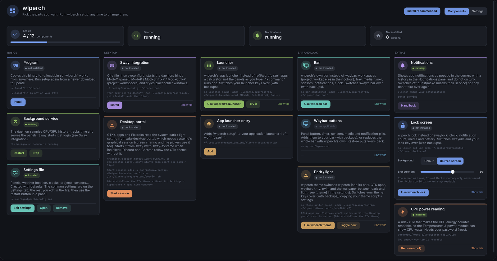

The setup window lists each component with its status (installed, update
available, not installed, set up elsewhere) and actions.

**Your own keys.** wlperch's sway file binds a few keys (`$mod+o` for the
panel, `$mod+p` for project workspaces, …). Open "Key bindings" on the Sway
integration card to switch each one on or off and give it another key before
anything is installed. setup asks `sway -C` whether your sway config already
uses a key; clashes turn red, and Install changes nothing until they're
resolved:

| 1. A key you already use | 2. Pick another | 3. Install |
|---|---|---|
| 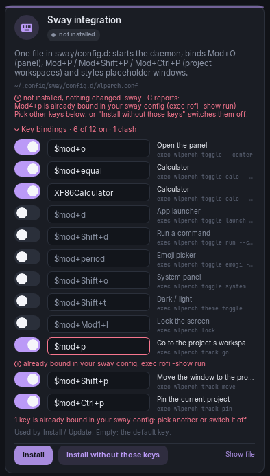 | 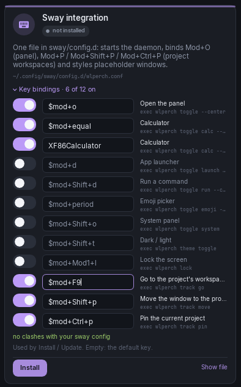 | 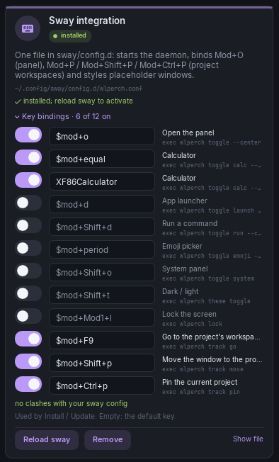 |

Each component, and what it does (you can preview each file before it's
written):

| Component | What it does |
|---|---|
| Program | copies the running binary to `~/.local/bin/wlperch` (or updates it) |
| Background service | starts or restarts the daemon |
| Settings file | creates `~/.config/wlperch/config.ini`, or opens it |
| Sway integration | writes `~/.config/sway/config.d/wlperch.conf` (daemon, bindings, placeholder style); recognises a hand-made setup; reloads sway. "Key bindings" on the card lists all of wlperch's bindings (the optional ones too) to switch on or off and give other keys before installing; keys your sway config already binds turn red, found with `sway -C` against your own config. Choices are kept in `~/.local/share/wlperch/sway-keys` and used by Install / Update. Installing checks again and changes nothing if a clash remains ("Install without those keys" switches the clashing ones off); every reload setup does is checked the same way |
| Waybar buttons | installs `wlperch.jsonc/.css` and adds the include, the button and the `@import` to your bar config, keeping `*.before-wlperch` backups |
| Waybar: replace whole bar | swaps your waybar `config.jsonc` (or `config`) and `style.css` for wlperch's complete bar ([`contrib/waybar/full/`](contrib/waybar/full)); see below |
| CPU power reading | installs the RAPL udev rule through `pkexec` (your polkit password prompt) |
| App launcher entry | `~/.local/share/applications/wlperch-setup.desktop` |

"Install recommended" does everything except the root-owned udev rule.

Every component can be removed again from its card. Removing undoes setup's own
edits: the include line in your sway config, and the include, our modules and
the `@import` in your waybar config (with `*.before-wlperch` backups). A removed
settings file is kept as `config.ini.before-wlperch`. Destructive actions ask
for a second click.

The **Settings** tab (top right, or "Edit settings" on the Settings file card)
edits the config keys you're likely to change without opening the file: the
panel (close on click outside, position, width, GPU release), clocks and weather
(24-hour clock, world clocks, location, units, night light command), the bar
(position, height, clock format, tray icon size, outputs, sensor room), the
memory thresholds, the lock screen (background, colours, picture, blur, what it
shows), the time tracker's break timeout, GitHub, the launcher's terminal and
the per-mode dark / light targets (wallpaper, GTK / icon / kitty / nvim / VS Code
/ Kvantum themes) and the setup window's own dim. Each has its help line and a filter box finds them. Changes
are written into `config.ini` as you make them (typing and dragging are
debounced), one key at a time with your comments and layout kept; "reset"
removes the key so the default applies again. They take effect by themselves:
the daemon restarts (keeping its state), the bar re-reads the file, the lock
screen uses them the next time it locks and a dark / light target for the other
mode at the next switch. Panels, sensors, display presets, projects and theme
commands stay in the file.

While the setup window floats and has focus, the rest of the screen (other
windows and the bar, on every output) is dimmed around it, fading in and out.
The dim is a layer surface of the setup process with a hole shaped like the
window's rounded card; it follows the window while it is dragged or resized
(polling sway's tree at frame rate only while something moves) and goes away
when the window is tiled, fullscreen, on a hidden workspace or loses focus to
another window. A click on the dim closes setup, like Escape; the window and
the resize strip around its edges work as before. Being part of the setup
process, the dim also disappears if that process crashes. `[setup]
dim_background = false` (or the Settings tab) turns it off, `dim_strength`
sets how dark it is; both apply to an open window right away.

"Replace whole bar" is the aggressive option: your config and `style.css` are
renamed to `*.before-wlperch-full` (with a timestamp when that name is taken;
existing backups are never overwritten, and symlinks into a dotfiles folder
are moved as links, so their targets stay untouched). The first line of each
file it writes names that backup. "Restore my bar" renames them back; if you
edited wlperch's files in the meantime, your edits are kept as
`*.wlperch-full-edited`.

### Updates

Once a day (`[update] check_daily = true`) the daemon asks GitHub whether a
newer wlperch release exists; that is one request to the GitHub API. The
update button in the main panel's header (left of the monitor-off button)
shows the result in its tooltip and checks again when clicked. When a release
is waiting it turns green with a dot, a line goes into the notification
history, and a click installs it: the tarball for your CPU (x86_64 or
aarch64) is downloaded, checked against the release's `SHA256SUMS`, its
`wlperch --version` is run, and it replaces `~/.local/bin/wlperch`; then the
daemon (and a running `wlperch-bar`) restart on it. From a terminal:

```sh
wlperch update check   # just look
wlperch update         # look, and install if there is something newer
```

## Building

Requirements: `odin` (tested with dev-2026-10), `clang`, `python3`, `git`,
`pkg-config`, and the development files for wayland-client, wayland-egl, EGL,
xkbcommon and freetype2. You also need `wayland-protocols` and `wlr-protocols`.

```sh
./build.sh          # release build -> build/wlperch (+ build/vptr test tool)
./build.sh debug    # debug build
./build.sh test     # unit tests
./build.sh install  # copy to ~/.local/bin (or just run build/wlperch: setup)
```

On the first build, `build.sh` clones [odin-imgui](https://gitlab.com/L-4/odin-imgui)
at a pinned commit into `third_party/`. It generates the bindings and compiles
Dear ImGui with FreeType and 32-bit `ImWchar` (needed for the Material Design
icons above U+FFFF).

Release tarballs (x86_64 and aarch64, linked against a Debian 12 sysroot so they
run on glibc 2.34+) are built with `tools/release/release.sh`; it fetches pinned,
checksummed inputs and needs only clang and lld. See
[tools/release/README.md](tools/release/README.md).

Runtime tools used: `pactl`, `busctl`, `curl`, `wl-copy`, `bluetoothctl`,
`wlsunset`, `setsid`. NVIDIA GPU stats come from NVML (`libnvidia-ml.so.1`,
loaded at runtime); AMD GPUs use sysfs.

## Running

```sh
wlperch            # = toggle: show, or hide if shown (starts the daemon if needed)
wlperch toggle system # open a specific panel (switches if another one is open)
wlperch toggle --center  # centred on the screen instead of the configured corner (for key bindings)
wlperch show [panel] | hide | quit
wlperch restart    # new binary + re-read config; keeps graph history
wlperch audio refresh   # fix stuck audio: card profile away and back
wlperch audio restart   # restart the PipeWire stack
wlperch track ACME # open the project's workspaces (time tracking)
wlperch track go        # back into the current (or last used) project's workspaces
wlperch track move      # move the focused window to that project's workspace on this monitor
wlperch track pin       # for a minute, go/move target this project from anywhere
wlperch track lock on   # group-lock monitors into/out of project workspaces
wlperch track keep on   # placeholder windows keep empty project workspaces
wlperch media play-pause # also play, pause, next, previous [player]
wlperch toggle calc     # the calculator popup (bind it to a key)
wlperch toggle launch --center  # the app launcher (apps, sums, panels)
wlperch toggle run --center     # the launcher's command mode
wlperch toggle emoji --center   # the emoji picker
wlperch calc '0x1f * 3' # print a result as decimal, hex, octal, binary, f64/f32 bits, hex float
wlperch notify dnd [on|off]  # do not disturb (no argument: toggle)
wlperch notify clear    # empty the notification history
wlperch notify dismiss  # close the popups on screen
wlperch notify status   # "<unread> <dnd 0|1> <serving 0|1>"
wlperch ssh             # SSH keys in the agent (also: unlock <key>, forget <key>, forget-all, lock, unlock-agent)
wlperch daemon     # start in the background without showing
wlperch status     # waybar JSON for the bar button (see below)
```

The first invocation becomes the daemon, and later ones just send a command over
`$XDG_RUNTIME_DIR/wlperch-$WAYLAND_DISPLAY.sock`. The daemon keeps sampling
CPU/GPU at 1 Hz, so the graphs are already full when you open the popup.

### Sway

Everything sway needs is in **one file**, [`contrib/sway/wlperch.conf`](contrib/sway/wlperch.conf):
- `exec wlperch daemon`;
- the panel toggle (`$mod+o`) and the calculator (`$mod+equal`, and the
  keyboard's calculator key), which open centred (`--center`) because you're
  working from the keyboard; bar clicks keep the configured corner;
- the project-workspace bindings (`$mod+p` / `$mod+Shift+p`);
- the placeholder window style.

`./build.sh install` copies it to `~/.config/sway/config.d/wlperch.conf`
unless a config already starts the daemon. Edit it there. At runtime, wlperch
itself only adds the per-workspace placement rules for placeholder windows,
because those depend on your project names.

### Waybar

The bar buttons come in two files, [`contrib/waybar/wlperch.jsonc`](contrib/waybar/wlperch.jsonc)
(module definitions) and [`contrib/waybar/wlperch.css`](contrib/waybar/wlperch.css)
(their styling, matching the popup). `./build.sh install` copies them into
`~/.config/waybar/` if they aren't there yet. It never edits your own
config. Hook them up with three lines:

```jsonc
// config.jsonc
"include": ["wlperch.jsonc"],
"modules-right": [ ..., "group/media", "custom/timer", "custom/sensors", "memory", "clock", "tray", "custom/notifications", "custom/wlperch" ],
```
```css
/* style.css, at the top */
@import "wlperch.css";
```

| Module | Shows | Click |
|---|---|---|
| `custom/wlperch` | panel button; red with `92%` when memory use passes `[memory] critical_percent` | main panel |
| `group/media` | ⏮ · `⏸ Artist — Title` · ⏭ while something plays (hidden otherwise); green while playing | play/pause (scroll: previous/next, right click: main panel); ⏮/⏭ skip |
| `custom/timer` | `⏱ ACME 1:23` while a project is counted, dim otherwise | time panel |
| `custom/sensors` | `bar_room` temperature + latest CO₂; orange >800 ppm, red >1200 ppm | sensors panel |
| `custom/notifications` | bell; purple with the count when there are unread notifications, bell-off under do not disturb | notifications panel (right click: do not disturb) |
| `memory` | waybar's own module | system panel |

The buttons are fed by `wlperch status`, `status timer`, `status sensors`, `status notifications` and `status media [prev|next]`,
small standalone loops that print waybar JSON.

## Configuration

The config lives at `~/.config/wlperch/config.ini` and is written with
defaults on the first run:

```ini
[popup]
width = 860
anchor = top right            # any of: top bottom left right
margin = 4 0 0 0              # top right bottom left
output =                      # connector (e.g. DP-1); empty = focused output
close_on_click_outside = true
max_height = 0                # 0 = up to the output height; scrolls when needed
release_gpu_after = 30        # seconds hidden before GPU memory is released (0 = never)

[weather]
location = auto               # auto | place name ("Ghent") | "lat,lon"
units = metric                # metric | imperial

[clocks]
zones = local, UTC, America/New_York=New York, Asia/Tokyo=Tokyo
use_24h = true

[network]
public_ip_url = https://api.ipify.org
ignore_interfaces = lo, docker, veth, br-, virbr, tailscale

[nightlight]
command = wlsunset -l {lat} -L {lon}   # {lat}/{lon} come from the weather location

[display.desk]                # display presets: see "Display presets" above
DP-3 = 3440x1440 pos 0 0
DP-1 = 2560x1440 pos 3440 0 transform 90

[system]
history_seconds = 120         # span the system graphs show by default (zoom out to 1 h)

[memory]
warn_free_percent = 15        # low-memory card when available memory < this % of RAM (0 = off)
bar_warn_percent = 75         # bar memory module orange + slowly pulsing from this use (%)
critical_percent = 90         # bar memory module, wlperch button and memory card red from this use (%)
                              # (was [system] memory_warn_percent, which still works)

[sensors]
dir =                         # directory with a tinytuya devices.json (see Sensors)
bar_room =                    # room shown by "wlperch status sensors" (empty = first)

# [sensor.kitchen]            # or define devices here (see Sensors)

[notifications]
enabled = true                # serve desktop notifications (takes over from dunst/mako)
hold_when_idle = 5            # popups wait after this many s without input (0 = off)
fullscreen = games            # popups keep off a monitor with a fullscreen game (games | all | off)

[github]
enabled = false               # GitHub panel via the gh CLI (run "gh auth login" first)
repo =                        # optional owner/name to follow too (checks, runs, releases)
refresh_minutes = 5

[ssh]
lifetime = 60                 # minutes an unlocked key stays in the agent (1-1440; 0 = until forgotten)
forget_on_lock = true         # wlperch lock empties the agent (ssh-add -D)
forget_on_idle = 0            # empty it after this many minutes without input (0 = off)
keys =                        # names or paths to list, comma separated; empty = every key in ~/.ssh

[lock]
pam_service =                 # empty: "swaylock" if /etc/pam.d/swaylock exists, else "login"
background = #14161b          # colour behind the clock
image =                       # optional picture (PNG/JPEG) instead, cover-fitted
blur = 0                      # blur the picture this much (e.g. 16); 0 = sharp
dim = 0.35                    # darken the picture (0..1)
background_mode =             # color, image or blur (the screen, frosted); empty: image if set, else color
screenshot_blur = 60          # blur strength for background_mode = blur (0..100; 0 is still unreadable)
blur_animate_ms = 0           # blur mode: grow the blur over this long after locking (max 3000; 0 = off)
blur_animate_from = 10        # ... starting at this % of the blur (0 = sharp; readable for a moment!)
show_notifications = true     # unread count + app names (never the text)
show_media = true             # the playing track
show_bluetooth = true         # connected Bluetooth devices and their battery
all_monitors = true           # password field and status on every monitor (false: focused one only)

[launcher]
terminal =                    # for Terminal=true apps, e.g. "alacritty -e"; empty: $TERMINAL, sway's $term, …

[setup]
dim_background = true         # dim the rest of the screen while "wlperch setup" is open and focused
dim_strength = 40             # how dark, in % (5..90; the light theme uses 3/4 of it)

# Panels: the first is the default. columns: modules per column, separated by |
[panel.main]
header = true                 # big clock and date
columns = quick media audio calculator | weather clocks displays bluetooth

[panel.system]
title = System                # compact title row when there's no header
width = 1180
columns = cpu memory storage | gpu thermals network | processes

[panel.sensors]
title = Home
width = 560
columns = sensors

[panel.notifications]
title = Notifications
width = 560
columns = notifications

[panel.calc]                  # wlperch toggle calc
title = Calculator
width = 560
tab = false                   # no tab in the tab strip
columns = calculator

[panel.timer]                 # the bar's timer opens this one (the Time tab stays as is)
title = Time
width = 600
tab = false
bare = true
columns = time

[panel.audio]                 # the bar's volume control opens this one
title = Audio
width = 520
tab = false
bare = true                   # only the audio card: no header, title row or tabs
columns = audio

[panel.launch]                # wlperch toggle launch (the run and emoji panels are alike)
width = 680
tab = false
columns = launcher

[panel.time]
title = Time
width = 600
columns = time

[panel.github]                # dropped while [github] is disabled
title = GitHub
width = 1120
columns = github | github-repo github-inbox

[timetracker]
idle_seconds = 300            # no input this long = a break (idle_minutes still works)
bridge_breaks = 0             # minutes: shorter breaks between work on one project count as work
currency = €                  # the unit of the rates: a symbol or a code (EUR)

[project.acme]                # one section per project
name = ACME                   # workspaces "ACME 1", "ACME 2", ...
client = ACME Corp            # omit for personal projects
color = #7aa2f7               # optional
bridge_breaks = 10            # optional: this project's own bridging (minutes, 0 = off)
paying = true                 # optional: a paid job (cash icon)
rate = 85                     # optional: hourly rate, for the export's amount
claude_counts = true          # optional: Claude Code working on its workspaces counts as work
```

Restart the daemon (`wlperch quit`) to apply changes.

## Resource use

When hidden, the daemon uses ~0 % CPU and ~40 MB RSS (about 24 MB of that is
NVML). It doesn't create an EGL context until the popup is first shown. GPU
drivers don't give their memory back on `eglTerminate`, so after the popup has
been hidden for `release_gpu_after` seconds (30 by default) the daemon
**re-executes itself**. It keeps the same PID
and the control socket, and hands the graph history over in a memfd, which
returns RSS to the baseline. Opening the popup takes ~25 ms while GPU state is
warm and ~140 ms after a release. While visible, it redraws once per second plus
on input.

## Layout of the code

```
build.sh                 build orchestration
tools/wlscan/            Wayland protocol XML -> Odin bindings generator
tools/vptr/              virtual-pointer tool used to click through the UI in tests
src/wl/                  libwayland bindings (client.odin hand-written, proto_*.odin generated)
src/xkb/                 minimal libxkbcommon bindings
src/platform.odin        Wayland globals, seat input -> ImGui, layer surfaces, EGL
src/main.odin            CLI, daemon, event loop, frame rendering
src/ipc.odin             control socket
src/reexec.odin          memory-returning self re-exec with state hand-over
src/theme.odin           fonts, palette, ImGui style
src/widgets.odin         custom-drawn widgets
src/ui.odin              the popup layout
src/tuya.odin            Tuya LAN protocol: discovery broadcasts, 3.3/3.4/3.5 status queries
src/{audio,sysmon,procs,sensors,sway,weather,network,bluetooth,nightlight,displays,clocks,storage}.odin  data services
src/notifications.odin   notification server (D-Bus via sd-bus), history, do not disturb
src/notify_popup.odin    software-rendered notification popups (layer surfaces + shm)
src/notify_icons.odin    icon lookup and decoding (theme, PNG/JPEG, SVG via librsvg)
src/memwarn.odin         low-memory warning: threshold with hysteresis, offenders, the shm card, signals
src/media.odin           MPRIS players (sd-bus): scan, commands, `status media`
src/calc.odin            calculator: expression parser/evaluator, number formats, `wlperch calc`
src/github.odin          GitHub through gh (GraphQL search like `gh status`, notifications, runs)
src/dbus.odin            minimal sd-bus bindings
src/softtext.odin        stb_truetype text into pixel buffers (placeholders, popups, lock screen)
src/lock.odin            `wlperch lock`: ext-session-lock-v1 lock screen (own process, shm rendering)
src/pam.odin             minimal PAM bindings for the lock screen
src/setup_lock.odin      setup component: switch swayidle / the lock key from swaylock and back
src/launcher.odin        launcher data: desktop entries, $PATH, matching, usage counts, starting apps
src/ui_launcher.odin     the launcher module (search field, rows, calculator row, keys)
src/setup_menu.odin      setup component: switch rofi/wofi/fuzzel/… key bindings to the launcher and back
src/config_switch.odin   rewriting sway files with backups and restoring them (lock screen, launcher, bar)
src/bar.odin             `wlperch bar`: layer surfaces per output, input, tooltips and tray menus (own process, shm)
src/bar_draw.odin        the bar's palette and software drawing (rounded rects, text, icons)
src/bar_modules.odin     the bar's modules: data worker, items, clicks and scrolling, clock and calendar
src/bar_sway.odin        the bar's sway subscription: workspaces (and project groups), mode, scratchpad, titles
src/bar_tray.odin        StatusNotifierWatcher/Host and dbusmenu
src/setup_bar.odin       setup component: switch sway's bar from waybar/swaybar to wlperch bar and back
src/config_edit.odin     config.ini edits that keep comments; the settings table, validated with config.odin's limits
src/setup_settings.odin  setup's Settings tab: controls, debounced writes, restarting the daemon to apply
src/setup_dim.odin       setup's dim around its window: layer surfaces with a rounded hole that follow sway's tree
src/ssh.odin             SSH keys: ~/.ssh scan, ssh-add actions, the expiry records, the daemon's state, `wlperch ssh`
src/ui_ssh.odin          the SSH keys card and its quick settings tile
src/askpass.odin         `wlperch askpass`: the SSH_ASKPASS passphrase popup (own process, shm)
src/setup_ssh.odin       setup component: OpenSSH's ssh-agent socket, SSH_AUTH_SOCK for the login, AddKeysToAgent
```

## Licenses

Fonts in `assets/fonts` are under their own licenses (Inter: OFL, JetBrains
Mono: OFL, Nerd Fonts Symbols: MIT). See the license files next to them.

The binary embeds only the icons it uses from the Nerd Fonts symbol font
(`SymbolsNerdFont-Subset.ttf`, ~24 KB instead of ~2.4 MB). After adding an
icon, run `python3 tools/subset_symbols.py` (needs `pip install fonttools`);
`./build.sh test` fails until you do.
